# Design Document

## Overview

VendorConnect is a mobile-first, offline-capable platform designed specifically for India's street food ecosystem. The platform addresses the unique challenges of street food vendors through a multilingual, voice-enabled interface that works efficiently on low-bandwidth networks. The system employs an offline-first architecture with intelligent data synchronization, ensuring vendors can manage their business operations regardless of network connectivity.

The platform integrates four key user experiences: vendor operations (sourcing, order management, community), supplier marketplace management, customer ordering and discovery, and delivery coordination. All interactions are optimized for users with varying levels of digital literacy through voice assistance and simplified UI patterns.

## Architecture

### System Architecture

The VendorConnect platform follows a distributed, offline-first architecture with the following key components:

```mermaid
graph TB
    subgraph "Mobile Apps"
        VA[Vendor App]
        CA[Customer App]
        DA[Delivery Agent App]
    end
    
    subgraph "Web Dashboard"
        SD[Supplier Dashboard]
        AD[Admin Dashboard]
    end
    
    subgraph "API Gateway Layer"
        AG[API Gateway]
        AUTH[Authentication Service]
        RATE[Rate Limiter]
    end
    
    subgraph "Core Services"
        VS[Vendor Service]
        OS[Order Service]
        PS[Payment Service]
        NS[Notification Service]
        CS[Community Service]
        AS[Analytics Service]
    end
    
    subgraph "AI/ML Services"
        VR[Voice Recognition]
        TTS[Text-to-Speech]
        TR[Translation Service]
        REC[Recommendation Engine]
    end
    
    subgraph "Data Layer"
        PDB[(Primary Database)]
        CACHE[(Redis Cache)]
        FS[File Storage]
        SEARCH[Search Engine]
    end
    
    subgraph "External Services"
        UPI[UPI Gateway]
        SMS[SMS Service]
        MAPS[Maps API]
        PUSH[Push Notifications]
    end
    
    VA --> AG
    CA --> AG
    DA --> AG
    SD --> AG
    AD --> AG
    
    AG --> AUTH
    AG --> RATE
    AG --> VS
    AG --> OS
    AG --> PS
    AG --> NS
    AG --> CS
    AG --> AS
    
    VS --> VR
    VS --> TTS
    VS --> TR
    OS --> REC
    
    VS --> PDB
    OS --> PDB
    PS --> PDB
    CS --> PDB
    AS --> PDB
    
    VS --> CACHE
    OS --> CACHE
    
    PS --> UPI
    NS --> SMS
    NS --> PUSH
    OS --> MAPS
```



### Offline-First Architecture

The mobile applications implement an offline-first approach where:

1. **Local Storage**: SQLite databases store critical data locally
2. **Sync Engine**: Background synchronization when connectivity is available
3. **Conflict Resolution**: Last-write-wins with timestamp-based conflict resolution
4. **Progressive Sync**: Prioritizes critical data (orders, payments) over non-essential data
5. **Bandwidth Optimization**: Compresses data and uses delta synchronization

### Voice Processing Architecture

The multilingual voice system uses a hybrid approach:

1. **On-Device Processing**: Basic voice commands processed locally for instant response
2. **Cloud Processing**: Complex natural language understanding handled by cloud services
3. **Language Detection**: Automatic detection of spoken language from supported regional languages
4. **Fallback Mechanisms**: Text input available when voice recognition fails

## Components and Interfaces

### Mobile Application Components

#### Vendor App Components

**VendorDashboard**
- Displays daily summary, pending orders, and quick actions
- Voice-activated navigation and status updates
- Offline-capable with cached data display

**SupplierMarketplace**
- Product catalog browsing with search and filtering
- Group order participation interface
- Price comparison and supplier verification status

**OrderManagement**
- Real-time order notifications with voice alerts
- Order acceptance/rejection with voice confirmation
- Preparation status updates and customer communication

**VoiceAssistant**
- Multilingual speech recognition supporting Hindi, English, Tamil, Telugu, Bengali, Marathi, Gujarati, Kannada, Malayalam, Punjabi, Odia, and Assamese
- Context-aware command processing
- Voice feedback for all major actions

**CommunityHub**
- Discussion forums organized by topics and regions
- Learning content delivery in multiple formats
- Peer-to-peer knowledge sharing platform

#### Customer App Components

**VendorDiscovery**
- Location-based vendor search with map integration
- Vendor profiles with menus, ratings, and availability
- Wishlist management for favorite vendors

**OrderPlacement**
- Cart management with real-time pricing
- Scheduling options for future orders
- Multiple payment method integration

**OrderTracking**
- Real-time order status updates
- Delivery tracking with estimated arrival times
- Digital receipt generation and storage

#### Delivery Agent App Components

**TaskManagement**
- Available delivery task browsing
- Route optimization and navigation integration
- Earnings tracking and payment history

**DeliveryTracking**
- Real-time location sharing with customers
- Status update interface for pickup and delivery
- Photo confirmation for completed deliveries

### Backend Service Interfaces

#### Vendor Service API

```typescript
interface VendorService {
  // Vendor management
  registerVendor(vendorData: VendorRegistration): Promise<VendorProfile>
  updateVendorProfile(vendorId: string, updates: VendorUpdate): Promise<VendorProfile>
  getVendorProfile(vendorId: string): Promise<VendorProfile>
  
  // Voice processing
  processVoiceCommand(audioData: ArrayBuffer, language: string): Promise<VoiceResponse>
  synthesizeSpeech(text: string, language: string): Promise<ArrayBuffer>
  
  // Analytics
  getVendorAnalytics(vendorId: string, period: TimePeriod): Promise<AnalyticsData>
}
```

#### Order Service API

```typescript
interface OrderService {
  // Order lifecycle
  createOrder(orderData: OrderCreation): Promise<Order>
  updateOrderStatus(orderId: string, status: OrderStatus): Promise<Order>
  getOrderHistory(userId: string, userType: UserType): Promise<Order[]>
  
  // Real-time updates
  subscribeToOrderUpdates(orderId: string): EventStream<OrderUpdate>
  
  // Group orders
  createGroupOrder(productId: string, initiatorId: string): Promise<GroupOrder>
  joinGroupOrder(groupOrderId: string, vendorId: string, quantity: number): Promise<GroupOrder>
}
```

#### Payment Service API

```typescript
interface PaymentService {
  // Payment processing
  initiatePayment(paymentData: PaymentRequest): Promise<PaymentResponse>
  verifyPayment(paymentId: string): Promise<PaymentStatus>
  processRefund(paymentId: string, amount: number): Promise<RefundResponse>
  
  // UPI integration
  generateUPIQR(merchantId: string, amount: number): Promise<string>
  validateUPITransaction(transactionId: string): Promise<TransactionStatus>
}
```

## Data Models

### Core Entity Models

#### Vendor Model

```typescript
interface Vendor {
  id: string
  businessName: string
  ownerName: string
  phoneNumber: string
  email?: string
  location: GeoLocation
  businessType: string
  preferredLanguage: SupportedLanguage
  verificationStatus: VerificationStatus
  rating: number
  totalOrders: number
  joinDate: Date
  isActive: boolean
  businessHours: BusinessHours[]
  paymentMethods: PaymentMethod[]
  rewardPoints: number
}

interface GeoLocation {
  latitude: number
  longitude: number
  address: string
  city: string
  state: string
  pincode: string
}

interface BusinessHours {
  dayOfWeek: number
  openTime: string
  closeTime: string
  isOpen: boolean
}
```

#### Order Model

```typescript
interface Order {
  id: string
  customerId: string
  vendorId: string
  items: OrderItem[]
  totalAmount: number
  status: OrderStatus
  orderType: OrderType
  scheduledTime?: Date
  deliveryAddress: Address
  deliveryMethod: DeliveryMethod
  paymentMethod: PaymentMethod
  paymentStatus: PaymentStatus
  createdAt: Date
  updatedAt: Date
  estimatedPreparationTime: number
  actualPreparationTime?: number
  deliveryAgentId?: string
  specialInstructions?: string
}

interface OrderItem {
  productId: string
  productName: string
  quantity: number
  unitPrice: number
  totalPrice: number
  customizations?: string[]
}

enum OrderStatus {
  PLACED = 'placed',
  ACCEPTED = 'accepted',
  PREPARING = 'preparing',
  READY = 'ready',
  OUT_FOR_DELIVERY = 'out_for_delivery',
  DELIVERED = 'delivered',
  CANCELLED = 'cancelled'
}
```

#### Supplier Model

```typescript
interface Supplier {
  id: string
  businessName: string
  contactPerson: string
  phoneNumber: string
  email: string
  address: Address
  verificationStatus: VerificationStatus
  rating: number
  categories: ProductCategory[]
  deliveryAreas: string[]
  minimumOrderValue: number
  isActive: boolean
  businessLicense: string
  taxId: string
}

interface Product {
  id: string
  supplierId: string
  name: string
  description: string
  category: ProductCategory
  unit: string
  pricePerUnit: number
  minimumQuantity: number
  availableQuantity: number
  imageUrls: string[]
  isActive: boolean
  groupOrderEligible: boolean
  groupOrderMinQuantity?: number
  groupOrderDiscount?: number
}
```

#### Group Order Model

```typescript
interface GroupOrder {
  id: string
  productId: string
  initiatorVendorId: string
  targetQuantity: number
  currentQuantity: number
  pricePerUnit: number
  discountPercentage: number
  expiryTime: Date
  status: GroupOrderStatus
  participants: GroupOrderParticipant[]
  createdAt: Date
}

interface GroupOrderParticipant {
  vendorId: string
  quantity: number
  joinedAt: Date
  status: ParticipantStatus
}

enum GroupOrderStatus {
  ACTIVE = 'active',
  FULFILLED = 'fulfilled',
  EXPIRED = 'expired',
  CANCELLED = 'cancelled'
}
```

### Voice Processing Models

```typescript
interface VoiceCommand {
  id: string
  userId: string
  audioData: ArrayBuffer
  recognizedText: string
  language: SupportedLanguage
  intent: CommandIntent
  entities: Entity[]
  confidence: number
  timestamp: Date
}

interface VoiceResponse {
  responseText: string
  audioResponse: ArrayBuffer
  actionTaken: string
  success: boolean
  followUpRequired: boolean
}

enum SupportedLanguage {
  HINDI = 'hi',
  ENGLISH = 'en',
  TAMIL = 'ta',
  TELUGU = 'te',
  BENGALI = 'bn',
  MARATHI = 'mr',
  GUJARATI = 'gu',
  KANNADA = 'kn',
  MALAYALAM = 'ml',
  PUNJABI = 'pa',
  ODIA = 'or',
  ASSAMESE = 'as'
}
```

## Correctness Properties

*A property is a characteristic or behavior that should hold true across all valid executions of a system—essentially, a formal statement about what the system should do. Properties serve as the bridge between human-readable specifications and machine-verifiable correctness guarantees.*

Before defining the correctness properties, I need to analyze the acceptance criteria from the requirements document to determine which ones can be tested as properties.

### Property 1: Voice Assistant Language Consistency
*For any* voice command in a supported regional language, the Voice_Assistant should respond in the same language as the input command
**Validates: Requirements 1.2, 7.1**

### Property 2: Vendor Registration Data Validation
*For any* vendor registration attempt, if required fields are missing, the system should identify and prompt for all missing fields through both visual and voice feedback
**Validates: Requirements 1.4**

### Property 3: Speech-to-Text Conversion Accuracy
*For any* valid business information provided through voice input, the system should accurately convert speech to text and successfully validate all required fields
**Validates: Requirements 1.3**

### Property 4: Verified Supplier Display Filter
*For any* vendor accessing the supplier marketplace, all displayed suppliers should have verified status and current availability
**Validates: Requirements 2.1**

### Property 5: Transparent Pricing Display
*For any* product viewed by a vendor, the displayed price should include all fees and delivery costs with no hidden charges
**Validates: Requirements 2.2**

### Property 6: Search Results Relevance and Sorting
*For any* product search query, returned results should be relevant to the search terms and sorted by price and proximity
**Validates: Requirements 2.3**

### Property 7: Group Order Information Display
*For any* product with group ordering available, the display should include minimum quantity requirements and bulk pricing opportunities
**Validates: Requirements 2.5, 3.1**

### Property 8: Group Order State Management
*For any* group order, when a vendor joins, their quantity should be reserved and the group order status should be updated to reflect current progress
**Validates: Requirements 3.2, 3.5**

### Property 9: Group Order Completion Processing
*For any* group order that reaches minimum quantity, the system should automatically process the order and notify all participants
**Validates: Requirements 3.3**

### Property 10: Group Order Expiration Handling
*For any* group order that expires without meeting minimum quantity, participants should be notified and offered individual ordering options
**Validates: Requirements 3.4**

### Property 11: Order Notification Delivery
*For any* order placement, acceptance, modification, or payment event, all relevant parties should receive immediate notifications through appropriate channels
**Validates: Requirements 4.1, 4.4, 6.4, 9.3, 10.2, 12.3**

### Property 12: Order Information Completeness
*For any* order notification or display, all required information should be present including items, quantities, preferences, delivery requirements, and current status
**Validates: Requirements 4.2**

### Property 13: Order Status Consistency
*For any* order status change (acceptance, preparation updates, delivery updates, payment confirmation), the status should be immediately updated and visible to all relevant parties
**Validates: Requirements 4.3, 4.5, 6.4, 10.2**

### Property 14: Vendor Discovery Sorting
*For any* customer opening the app, nearby vendors should be displayed sorted by distance and availability status
**Validates: Requirements 5.1**

### Property 15: Vendor Profile Information Completeness
*For any* vendor profile viewed by a customer, all required information should be displayed including menu items, pricing, preparation times, and ratings
**Validates: Requirements 5.2**

### Property 16: Cart Calculation Accuracy
*For any* items added to a customer's cart, the total cost should accurately include all applicable fees including delivery charges
**Validates: Requirements 5.3**

### Property 17: Order Confirmation Information Provision
*For any* confirmed order, the system should provide estimated preparation and delivery times, generate a digital receipt, and provide tracking information
**Validates: Requirements 5.4, 5.5**

### Property 18: Delivery Options Availability
*For any* order received by a vendor, all delivery options (self-delivery, third-party, helper) should be presented with appropriate information
**Validates: Requirements 6.1**

### Property 19: Reward Points Calculation
*For any* self-delivery chosen by a vendor, reward points should be calculated and awarded based on delivery distance and order value
**Validates: Requirements 6.2**

### Property 20: Delivery Agent Information Provision
*For any* delivery task accepted by an agent, pickup and delivery addresses should be provided with navigation support
**Validates: Requirements 6.3**

### Property 21: Live Tracking Information Availability
*For any* delivery in progress, customers should have access to real-time tracking information
**Validates: Requirements 6.5**

### Property 22: Voice Command Processing and Confirmation
*For any* voice command spoken by a vendor, the system should process the request and provide audio confirmation of actions taken
**Validates: Requirements 7.2**

### Property 23: Voice Recognition Error Handling
*For any* failed voice recognition attempt, the system should ask for clarification and offer alternative input methods
**Validates: Requirements 7.3**

### Property 24: Voice Input Visual Feedback
*For any* voice command, the system should display the recognized text for user verification
**Validates: Requirements 7.4**

### Property 25: Community Forum Organization
*For any* vendor accessing the community section, discussion forums should be organized by topics relevant to street food business and filtered by region
**Validates: Requirements 8.1, 8.2**

### Property 26: Learning Content Format Availability
*For any* available learning content, it should be presented in multiple formats including text, audio, and video
**Validates: Requirements 8.3**

### Property 27: Community Contribution Recognition
*For any* valuable contribution shared by vendors, the system should highlight it and reward active participants
**Validates: Requirements 8.4**

### Property 28: Internship Matching Logic
*For any* available internship opportunity, vendors should be matched based on their interests and location
**Validates: Requirements 8.5**

### Property 29: Adaptive Content Loading
*For any* detected slow network condition, the system should automatically reduce image quality and defer non-essential content loading
**Validates: Requirements 9.1**

### Property 30: Offline Functionality and Synchronization
*For any* critical function like order management, it should work offline when connectivity is intermittent and automatically sync data when connection is restored
**Validates: Requirements 7.5, 9.2, 9.5**

### Property 31: Data Usage Monitoring
*For any* vendor with data usage approaching set limits, the system should notify them and offer data-saving mode
**Validates: Requirements 9.3**

### Property 32: Data-Saving Mode Behavior
*For any* system in data-saving mode, essential functions should be prioritized and background data usage should be minimized
**Validates: Requirements 9.4**

### Property 33: Payment Processing Integration
*For any* completed order, payment should be processed through integrated gateways supporting UPI, cards, and digital wallets
**Validates: Requirements 10.1**

### Property 34: Payment Failure Handling
*For any* failed payment, the system should retry the transaction and offer alternative payment methods
**Validates: Requirements 10.3**

### Property 35: Payment Dispute Resolution
*For any* payment dispute, transaction records should be available and resolution should be facilitated
**Validates: Requirements 10.5**

### Property 36: Analytics Display Completeness
*For any* vendor accessing analytics, daily, weekly, and monthly sales summaries should be displayed in easy-to-understand visual formats
**Validates: Requirements 11.1**

### Property 37: Order History Analysis
*For any* order history view, the system should show order patterns, peak times, and popular items
**Validates: Requirements 11.2**

### Property 38: Performance Trend Analysis
*For any* time period comparison, trends and changes in business performance should be highlighted
**Validates: Requirements 11.3**

### Property 39: Analytics Voice Narration
*For any* analytics review, voice narration of key insights should be available for vendors with reading difficulties
**Validates: Requirements 11.4**

### Property 40: Performance Recommendation Generation
*For any* data pattern indicating improvement opportunities, actionable recommendations should be suggested
**Validates: Requirements 11.5**

### Property 41: Supplier Dashboard Information Display
*For any* supplier accessing their dashboard, current inventory levels and product status should be displayed
**Validates: Requirements 12.1**

### Property 42: Low Inventory Handling
*For any* product with low inventory levels, the supplier should be notified and the product should optionally be hidden from vendor view
**Validates: Requirements 12.3**

### Property 43: Group Order Inventory Reservation
*For any* confirmed group order, inventory should be reserved and available quantities should be updated accordingly
**Validates: Requirements 12.4**

### Property 44: Dynamic Pricing Adjustment
*For any* pricing adjustment need, suppliers should be able to set dynamic pricing based on demand and inventory levels
**Validates: Requirements 12.5**

## Error Handling

### Voice Processing Error Handling

**Speech Recognition Failures**
- Automatic fallback to text input when voice recognition confidence is below 70%
- Multiple language detection attempts before defaulting to English
- Clear error messages in the user's preferred language
- Retry mechanisms with improved audio quality suggestions

**Network-Related Voice Errors**
- Local caching of common voice commands for offline processing
- Graceful degradation to text-only interface when voice services are unavailable
- Queue voice commands for processing when connectivity is restored
- User notification of voice service status

### Order Management Error Handling

**Order Processing Failures**
- Automatic retry mechanisms for failed order submissions
- Rollback capabilities for partially processed orders
- Clear error communication to all parties (vendor, customer, delivery agent)
- Alternative fulfillment options when primary vendor is unavailable

**Payment Processing Errors**
- Multiple payment gateway fallbacks (UPI → Card → Wallet)
- Secure storage of payment attempts for retry processing
- Clear error messages with suggested resolution steps
- Automatic refund processing for failed transactions after successful payment

### Data Synchronization Error Handling

**Offline-Online Sync Conflicts**
- Last-write-wins conflict resolution with user notification
- Data integrity checks before and after synchronization
- Backup and recovery mechanisms for critical data
- User-friendly conflict resolution interfaces for important data

**Network Connectivity Issues**
- Intelligent retry with exponential backoff
- Priority-based synchronization (orders > analytics > community posts)
- Bandwidth-aware sync strategies
- User notification of sync status and any issues

### System Availability Error Handling

**Service Degradation**
- Graceful degradation of non-essential features during high load
- Circuit breaker patterns for external service dependencies
- Health check endpoints for all critical services
- Automatic scaling based on demand patterns

## Testing Strategy

### Dual Testing Approach

VendorConnect employs a comprehensive testing strategy combining unit tests and property-based tests to ensure system reliability and correctness.

**Unit Testing Focus:**
- Specific examples demonstrating correct behavior for each user role
- Edge cases and error conditions (network failures, invalid inputs, payment failures)
- Integration points between mobile apps and backend services
- Voice processing accuracy with sample audio data
- Payment gateway integration with test transactions
- Offline-online synchronization scenarios

**Property-Based Testing Focus:**
- Universal properties that hold across all valid inputs and user scenarios
- Comprehensive input coverage through randomized test data generation
- Voice command processing across all supported languages
- Order lifecycle consistency across different order types and delivery methods
- Data synchronization integrity across network conditions
- Payment processing reliability across different payment methods

### Property-Based Testing Configuration

**Testing Framework:** 
- **Mobile Apps (React Native):** fast-check library for JavaScript/TypeScript
- **Backend Services (Node.js):** fast-check with custom generators for domain objects
- **Voice Processing:** Custom audio data generators with multilingual test samples

**Test Configuration:**
- Minimum 100 iterations per property test to ensure statistical confidence
- Custom generators for domain-specific objects (vendors, orders, products, voice commands)
- Shrinking strategies to find minimal failing examples
- Parallel test execution for performance optimization

**Property Test Tagging:**
Each property-based test must include a comment referencing its design document property:
```javascript
// Feature: vendor-connect, Property 1: Voice Assistant Language Consistency
test('voice responses match input language', () => {
  fc.assert(fc.property(
    voiceCommandGenerator(),
    (command) => {
      const response = processVoiceCommand(command);
      return response.language === command.language;
    }
  ), { numRuns: 100 });
});
```

### Integration Testing Strategy

**End-to-End User Flows:**
- Complete vendor onboarding process with voice assistance
- Full order lifecycle from customer placement to delivery completion
- Group ordering process from initiation to fulfillment
- Payment processing across different methods and failure scenarios
- Community interaction and learning content access

**Cross-Platform Testing:**
- Mobile app functionality across Android and iOS devices
- Voice processing accuracy across different device microphones
- Offline functionality across various network conditions
- Performance testing on low-end devices common in target markets

**Multilingual Testing:**
- Voice recognition accuracy across all 12 supported languages
- UI localization correctness for all supported languages
- Cultural appropriateness of content and interactions
- Right-to-left language support where applicable

### Performance and Load Testing

**Mobile Performance:**
- App startup time optimization for low-end devices
- Memory usage monitoring and optimization
- Battery usage optimization for background processes
- Data usage measurement and optimization

**Backend Performance:**
- Load testing for peak order volumes during meal times
- Database performance optimization for complex queries
- API response time monitoring and optimization
- Auto-scaling validation under varying loads

**Voice Processing Performance:**
- Speech recognition latency measurement and optimization
- Text-to-speech generation speed optimization
- Offline voice command processing performance
- Multilingual processing efficiency comparison